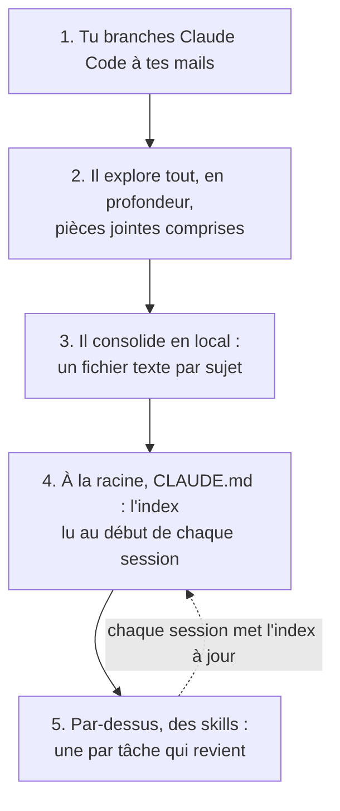

# Un second cerveau pour gérer ton activité, rempli depuis tes mails

Ce n'est pas une app. C'est un dossier de fichiers texte que Claude Code remplit à partir de tes
mails, puis lit au début de chaque session. Il se monte en cinq étapes. C'est pour un freelance
ou un petit patron qui a Claude Code, pas besoin d'être développeur.

C'est la forme du dossier avec lequel je gère mon activité de freelance. Ici, tu as le modèle vide.

> **Ta copie remplie contient tes données** : tes clients, tes montants, tes numéros fiscaux.
> Garde-la sur ton ordinateur ou dans un repo **privé**. Ne la pousse jamais sur un repo public.
> Le prompt de départ débranche ton dossier de ce repo pour éviter l'accident.

## Les cinq étapes



## Ce que tu obtiens

```
CLAUDE.md               l'index : échéances, une ligne par sujet ouvert, les règles
journal-des-mails.md    qui m'a écrit, quand, ce qui a été décidé
facturation.md          tes clients, ta numérotation, les factures émises et payées
identifiants.md         tous tes numéros (fiscal, TVA, entreprise), chacun avec sa pièce
sujets/                 une fiche par dossier de fond (un litige, un contrôle, un retard)
data/                   tes PDF et relevés, jamais versionnés
.claude/skills/         trois skills d'exemple : la facture du mois, le point avec le
                        comptable, préparer un virement
scripts/                Gmail par l'API : chercher, lire, télécharger les pièces jointes,
                        brouillon avec pièce jointe (jamais d'envoi)
scripts/revolut/        exemple bancaire : soldes, relevés, brouillons de virement
                        (Revolut Business, jamais de paiement)
secrets/                tes accès (créé chez toi, jamais versionné)
AUTOMATIQUE.md          lancer une skill tout seul, tous les mois
PROMPT.md               le prompt qui déroule les cinq étapes chez toi
```

Chaque fichier a ses colonnes et une ou deux lignes d'exemple, marquées « (exemple) » :
ACME SAS, Cabinet Dupont, des numéros en 0000. Claude les remplace par les tiennes.

## Démarrer

Il te faut Claude Code, connecté avec ton compte Claude (un
[abonnement](https://claude.com/pricing), pas une clé API : les connecteurs comme Gmail ne
marchent qu'avec la connexion par compte). Puis :

```
git clone https://github.com/vincentventalon/second-cerveau-compagnie mon-second-cerveau
cd mon-second-cerveau
claude
```

Dans Claude Code, tape : « Lis PROMPT.md et déroule-le. » Claude s'arrête après chaque étape et
attend ton accord avant la suivante.

## Brancher tes mails (étape 1)

Deux voies. Tu peux faire les deux : le connecteur pour lire, les scripts pour les pièces jointes.

### La voie simple : le connecteur Gmail

Les connecteurs s'ajoutent sur claude.ai, pas dans le terminal : va sur
`claude.ai/customize/connectors`, ajoute **Gmail** (et **Google Drive** si tes documents y sont).
Ils apparaissent ensuite tout seuls dans Claude Code : tape `/mcp` pour les voir.
([doc officielle](https://code.claude.com/docs/en/mcp#use-mcp-servers-from-claude-ai))

Deux limites à connaître
([doc des connecteurs Google](https://support.claude.com/en/articles/10166901-use-google-workspace-connectors)) :

- **Le connecteur Gmail ne lit pas le contenu des pièces jointes**, seulement leur nom. Claude te
  donne la liste des pièces qui comptent, tu les télécharges dans `data/pieces/`, et il les lit
  là : Claude Code lit les PDF posés dans le dossier. Le connecteur Google Drive, lui, lit les
  PDF qui sont dans ton Drive.
- **Le connecteur Gmail sait envoyer** un mail, répondre et transférer. Par défaut il te demande
  avant chaque envoi. Le prompt va plus loin : il fait poser une règle qui interdit ces outils
  dans ce dossier.

### La voie complète : les scripts Gmail

Compte 20 à 30 minutes la première fois. Si un écran de Google ne ressemble pas à ce qui est
écrit ici, dis à Claude ce que tu vois : il te guide.

Les scripts de `scripts/` parlent à l'API Gmail avec **ton propre accès Google**. Ils lisent les
pièces jointes et créent des brouillons qui portent un PDF. Ils n'ont pas de commande d'envoi.
Il faut les mettre en place une fois, dans la console Google Cloud
([guide officiel de Google](https://developers.google.com/workspace/gmail/api/quickstart/python)) :

1. Sur [console.cloud.google.com](https://console.cloud.google.com), crée un projet (« second
   cerveau »).
2. Active l'**API Gmail** pour ce projet (menu APIs et services, Bibliothèque, Gmail API).
3. Ouvre **Google Auth Platform**. Dans **Branding**, donne un nom d'app et ton adresse. Dans
   **Audience**, choisis **External** si tu as une adresse Gmail perso (**Internal** si c'est un
   compte Google Workspace de ta société), et ajoute ton adresse dans les **utilisateurs test**.
4. Dans **Clients**, crée un client de type **Desktop app**. Télécharge le JSON. Crée le dossier
   `secrets/google/` dans ton second cerveau (`mkdir -p secrets/google`) et range le fichier
   dedans sous le nom `client_secret.json`.
5. Dans le dossier, installe les outils. Il faut Python 3.10 ou plus récent (`python3 --version`
   te donne ta version ; sur Mac, `brew install python` installe une version récente). Le
   « venv » est un dossier d'outils isolé, créé dans ton second cerveau, qui ne touche pas au
   reste de ton ordinateur :

   ```
   python3 -m venv .venv
   .venv/bin/pip install -r scripts/requirements.txt
   .venv/bin/python scripts/auth_gmail.py
   ```

   Un navigateur s'ouvre : choisis ton compte, accepte. En Python 3.10, un `FutureWarning` de
   trois lignes s'affiche à chaque lancement : il est sans gravité. Google affiche un avertissement avant
   l'autorisation, parce que l'app est en mode test : c'est ton app, sur ton compte. Le token
   tombe dans `secrets/google/token.json`.
6. Test : `.venv/bin/python scripts/gmail_lib.py` affiche ton adresse et ton nombre de mails.

Les droits demandés : `gmail.readonly` (lire) et `gmail.compose` (brouillons). Tant que ton app
est en mode **Test**, Google coupe l'accès au bout de **7 jours** : relance
`scripts/auth_gmail.py`. `client_secret.json` et `token.json` ouvrent ta boîte : ils restent dans
`secrets/`, que `.gitignore` exclut.

Ce que tu lances ensuite :

```
.venv/bin/python scripts/gmail_cli.py search "from:compta@cabinet-dupont.example newer_than:90d"
.venv/bin/python scripts/gmail_cli.py thread <id_du_fil>
.venv/bin/python scripts/gmail_cli.py grab "has:attachment facture newer_than:1y" --out data/pieces --ext .pdf
.venv/bin/python scripts/gmail_cli.py draft --to <adresse> --subject "<objet>" --body-file <texte.txt> --attach <facture.pdf>
```

La requête suit la syntaxe de la recherche Gmail. `gmail_cli.py pdftext <fichier.pdf>` affiche le
texte d'un PDF, si tu as installé poppler (`brew install poppler` sur Mac).

Les scripts Gmail se lancent toujours avec `.venv/bin/python` (ils ont besoin des bibliothèques
Google installées dans le venv). Les scripts Revolut n'ont besoin de rien : `python3` suffit.

Sous Windows : les commandes sont écrites pour Mac et Linux. Le plus simple est de lancer Claude
Code dans WSL. Sinon, remplace `.venv/bin/python` par `.venv\Scripts\python.exe`.

## Brancher ta banque (en option, avec les skills de l'étape 5)

`scripts/revolut/` est un exemple avec Revolut Business (un compte pro Revolut, pas un compte
perso ; si ta banque est une autre, saute cette partie) : lire les soldes, sortir les relevés en
CSV, créer des brouillons de virement. L'accès se donne avec les permissions **READ** et
**WRITE** seulement. Selon la doc Revolut, WRITE permet de créer des brouillons de paiement, et
seule la permission PAY permet de lancer un virement : sans elle, aucun script ne peut payer. Le
brouillon apparaît dans l'app, et c'est toi qui l'envoies et l'approuves. La mise en place
(certificat, client ID, consentement) est pas à pas dans
[`scripts/revolut/README.md`](scripts/revolut/README.md).

## Quoi lancer en premier

1. Le connecteur Gmail, et le test des 5 derniers mails (étape 1 du prompt).
2. Les scripts Gmail, si tes pièces jointes comptent (factures, relevés : chez un freelance,
   elles comptent presque toujours).
3. Le prompt, étapes 2 à 5.
4. La banque, en dernier et seulement si tu veux, quand le dossier tourne.

## Comment les skills appellent les scripts

Une skill est un texte que Claude suit. Quand elle dit « télécharge les pièces jointes », elle
lui donne la commande : `.venv/bin/python scripts/gmail_cli.py grab ...`. Claude la lance dans
le terminal, lit le résultat, et te demande la permission avant chaque commande que tu n'as pas
encore autorisée. Sans les scripts, la même skill passe par le connecteur Gmail et te demande de
télécharger les pièces toi-même. Tu peux lire chaque skill dans `.claude/skills/<nom>/SKILL.md`
et la changer : c'est du texte.

## L'index, `CLAUDE.md`

Claude Code charge le `CLAUDE.md` du dossier au début de chaque session
([doc](https://code.claude.com/docs/en/memory)). C'est pour ça que l'index s'appelle comme ça :
tu n'as rien à lui rappeler. La mise à jour en fin de session, elle, n'est pas automatique :
c'est une règle écrite dans l'index, que Claude suit. La doc conseille de rester sous 200 lignes :
le détail va dans les fichiers par sujet, l'index n'en garde qu'une ligne.

## Les skills

Une skill, c'est un dossier `.claude/skills/<nom>/` avec un `SKILL.md` : un nom, une description
qui dit quand s'en servir, puis le déroulé ([doc](https://code.claude.com/docs/en/skills)).
Claude la lance quand ta demande y correspond, ou quand tu tapes `/<nom>`.

| Skill | Tu dis | Elle fait |
|---|---|---|
| `facture-du-mois` | « fais la facture d'octobre » | calcule, prépare la facture et le mail au client en brouillon |
| `point-comptable` | « fais le point avec le comptable » | lit les nouveaux mails, met l'index à jour, prépare les réponses en brouillon |
| `preparer-virement` | « prépare le virement au comptable » | lit tes soldes et crée un brouillon de virement que tu approuves dans ton app bancaire (exemple avec Revolut Business) |

Ce sont des exemples. À l'étape 5, Claude regarde ce qui revient dans tes mails et te propose les
tiennes.

## Ce que Claude a le droit de faire

| Oui | Non |
|---|---|
| Lire tes mails et la liste des pièces jointes | Envoyer, répondre, transférer un mail |
| Écrire des brouillons dans Gmail | Supprimer ou archiver un mail sans te demander |
| Lire tes soldes et tes opérations | Payer, valider ou envoyer un virement |
| Créer un brouillon de virement, si tu lui donnes cet accès | Mettre un secret ou un mot de passe dans un fichier |
| Écrire dans les fichiers de ce dossier | Pousser ce dossier sur un repo public |

Claude prépare, tu approuves. Ces règles sont écrites dans `CLAUDE.md`. Ce sont des consignes, pas
un verrou : la doc le dit, Claude les lit comme du contexte. Les verrous sont ailleurs : la règle
qui interdit les outils d'envoi du connecteur (posée à l'étape 1), des scripts Gmail sans
commande d'envoi, et une banque branchée sans la permission de payer.

## Lancer en automatique

Une skill peut tourner toute seule, par exemple le point avec le comptable le 1er du mois.
Comment faire et les limites : [`AUTOMATIQUE.md`](AUTOMATIQUE.md).

## Ce que ça coûte

Rien en plus de ton abonnement Claude : les connecteurs Gmail et Google Drive sont proposés à
tous les comptes Claude. L'exploration lit beaucoup de mails, et ça compte dans ta limite
d'usage. Commence par six mois si tu veux voir ce que ça donne avant d'élargir.

## Pannes courantes

| Ce que tu vois | Remède |
|---|---|
| Claude n'a aucun outil Gmail | Ajoute le connecteur sur `claude.ai/customize/connectors`, relance Claude Code, tape `/mcp`. |
| `/mcp` ne liste aucun connecteur claude.ai | Tape `/status` : tu es sans doute connecté par une clé API. Lance `/login` et choisis ton compte Claude. |
| Claude résume un relevé sans les montants | Il n'a lu que le mail, pas la pièce. Télécharge le PDF dans `data/` et redemande. |
| `Il manque .../secrets/google/client_secret.json` | Étape 4 des scripts Gmail : télécharge le JSON du client « Desktop app » à cet endroit. |
| `Pas de token Gmail` | Lance `.venv/bin/python scripts/auth_gmail.py`. |
| `invalid_grant` au bout d'une semaine | L'app Google est en mode Test : l'accès dure 7 jours. Relance `scripts/auth_gmail.py`. |
| `ModuleNotFoundError: No module named 'googleapiclient'` | Tu as lancé `python3` au lieu de `.venv/bin/python`, ou sauté le `pip install`. |
| `pdftoppm is not installed` sur un long PDF | Installe poppler (`brew install poppler` sur Mac). Au-delà de 10 pages, Claude lit le PDF par morceaux et en a besoin. |
| L'index dépasse 200 lignes | Demande à Claude de déplacer le détail dans `sujets/` et de garder une ligne par sujet. |

## Testé

Le 10/11/2026 : le modèle a été relu contre la doc officielle de Claude Code (skills,
`CLAUDE.md`, connecteurs, tâches planifiées), de l'API Gmail et de l'API Revolut Business. Les
scripts sont repris de ceux avec lesquels je gère mon activité, rendus génériques. Dans un
environnement Python neuf (Python 3.10, dépendances de `scripts/requirements.txt`), chaque script
compile et affiche son aide. Leur logique a tourné hors ligne, sur des réponses d'API simulées :
relevé CSV et contrôle des soldes, aperçu puis création d'un brouillon de virement, brouillon
Gmail avec pièce jointe dans le bon fil. Les connexions réelles (Google, Revolut) n'ont pas été
rejouées sur un compte neuf, et le prompt n'a pas encore été déroulé de bout en bout sur une
boîte mail neuve.

## Pour suivre

Je fais un challenge : une vidéo par jour sur [Instagram](https://www.instagram.com/vincentleserpent/)
et [TikTok](https://www.tiktok.com/@vincentleserpent_), et une newsletter le mardi :
[deviensdev.fr](https://deviensdev.fr). Si ce modèle t'a servi, une étoile sur le repo m'aide à
savoir quoi refaire.

## Licence

MIT
